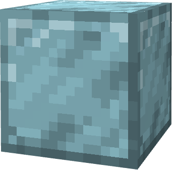
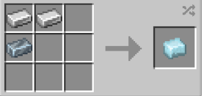
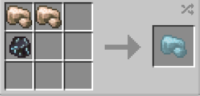

# Adamantium

{ width=182 height=179 loading=lazy }{ width=110 height=110 loading=lazy }{ width=107 height=107 loading=lazy }

The "**Adamantium**" can be found via placing two iron with one Vibranium in the crafting table and requires a "**Diamond Pickaxe or higher**" to mine.

{ width=222 height=106 loading=lazy }{ width=220 height=105 loading=lazy }

Uses:

* This ingot can be to enhance the [Bone Claws](../../powers/main-powers/mutations-x-gene/bone-claws/index.md) mutation.
  * This ingot can be used to craft Vibranium Shield and Adamantium Circuit.

Crafting Uses:

* Using ingots of this ore, various tools can be crafting using similar recipes to vanilla tools.
