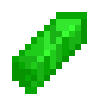
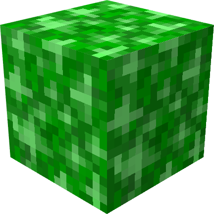

# Kryptonite

{ width="100" height="100" loading=lazy }{ width="132" height="132" loading=lazy }

The "**Kryptonite Block**" can be found in "[**Kryptonite Meteors**](../../structures/kryptonian-meteor.md)**"** in the overworld and requires a "**Iron Pickaxe or higher to mine**".

Uses:

- Mining this ore will drop 4 Kryptonite Shard.
- This block, and any variation of it's craftable versions can be used to weaken / inhibit any of the [Kryptonian](../../powers/main-powers/kryptonians-full/index.md) or [Half Kryptonian](../../powers/main-powers/kryptonians-half/index.md) variants
- When right click a Kryptonite Block with a Kryptonite Shard(in the overworld) it can grow more kryptonite shards overtime very slowly. 
- When holding or containing this block or any form of kryptonite(except for Batman(Kryptonite)Suit and Batman(Kryptonite) Utility Belt) will give you a Kryptonite Exposure Rate and when it reaches max you will get the wither 3 effect for 10 sec until you get rid of the kryptonite.

Crafting Uses:

* This ore can be broken down and used to craft various tools via similar recipes to the Vanilla Minecraft tools
