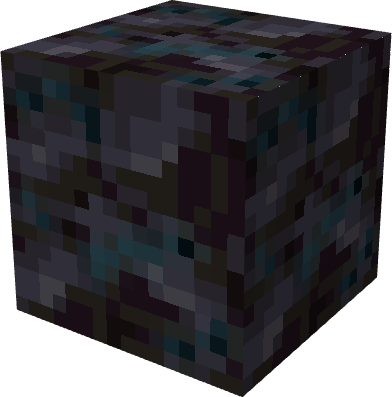
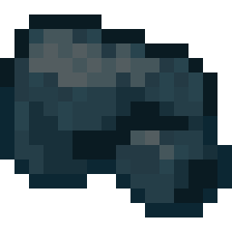
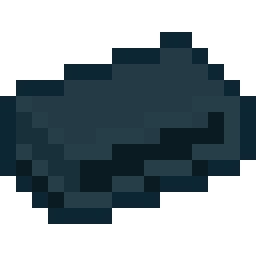
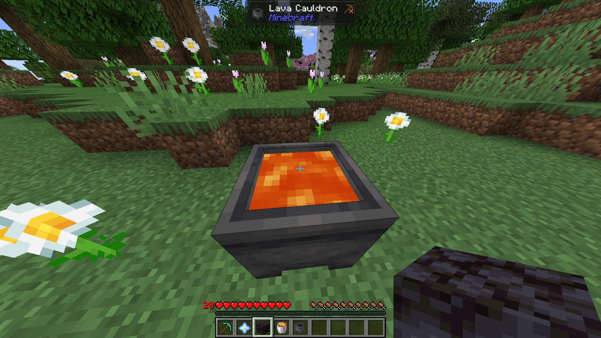
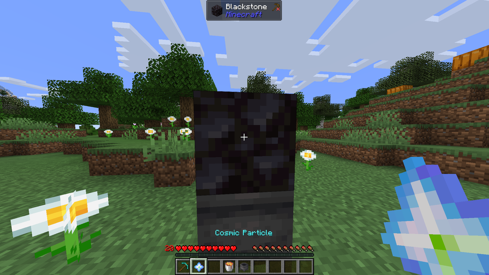
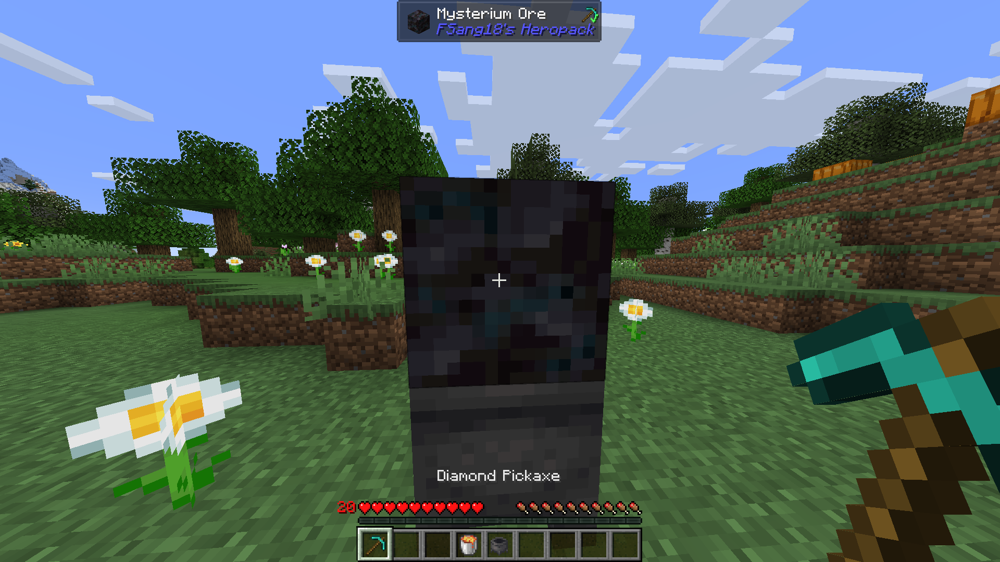

# Mysterium

{ width=142 height=143 loading=lazy }{ width="95" height="95" loading=lazy } { width="88" height="88" loading=lazy }

The "**Mysterium**" can be created via putting a blackstone on top of lava cauldron and click the blackstone with a [Cosmic Particle](../../items/cosmic-particle.md), requires a "**Diamond Pickaxe or higher to mine**".

**Step 1:**

{ width="809" height="454" loading=lazy }

**Step 2:**

{ width="900" height="507" loading=lazy }

**Step 3:**

{ width="900" height="507" loading=lazy }

Uses:

* Mining this ore will grant 1 piece of Raw Mysterium. This ore is affected by Fortune.

Crafting Uses:

- This ore can be used to craft [Model LXXII](../../suitsets/iron-man-suits/model-72.md).
- This ore has Anti Magic properties.
