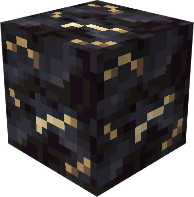
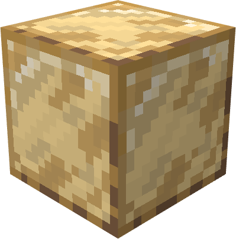
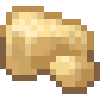
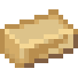

# Nth Metal

{ width=131 height=132 loading=lazy } { width=137 height=139 loading=lazy }  { width=100 height=100 loading=lazy }   { width=100 height=100 loading=lazy }

The "**Nth Metal**" can be found only in [**"Nth Meteor"**](../../structures/nth-meteor.md) and requires a "**Wooden Pickaxe or higher to mine**".

Uses:

* Mining this ore will grant 1 piece of Raw Nth. This ore is affected by Fortune.

Crafting Uses:

* Using the blocks / ingots, various Atlantean armors, Amazon weapons, Neptune's Trident etc can be crafted.
* Using the Nth templates Neptune's Trident can be upgraded in the power menu.
* Use this ore and the Martian Fossil to craft a [Green Martian](../../powers/main-powers/martians/green-martian.md) DNA.
