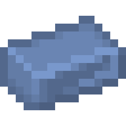
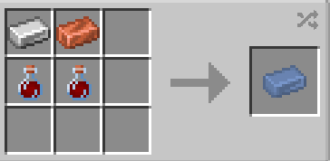

# Techno Organic Ingot

{ width=106 height=106 loading=lazy }       { width=104 height=104 loading=lazy }

The **_Techno-Organic Ingot_** can be obtained via placing x2 [Augmented Human DNA](../../items/material/augmented-human-dna.md), x1 Iron Ingot and x1 Copper Ingot into a crafting table”.

{ width=366 height=178 loading=lazy }

Uses:

* These ingots can be crafted into a block and used to further enhance the [Winged Flight](../../powers/main-powers/mutations-x-gene/winged-flight.md) and [En Sabah Nur ](../../powers/main-powers/mutations-x-gene/total-molecular-control.md)mutations to the their upgraded versions.
* This ingot can also be broken down an used to craft various tools.
* This ingot can be used at making the [Artificial Necrotech](../../powers/main-powers/artificial-necrotech.md).

Related Information:

- After crafted the ingot you will get back the syringes.
