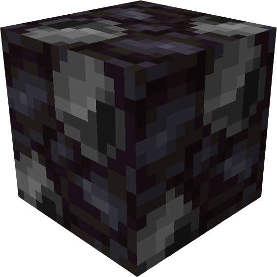
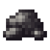
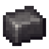

# Titanium

{ width=136 height=135 loading=lazy } { width=100 height=100 loading=lazy }{ width=100 height=100 loading=lazy }

The "**Titanium**" can be found via "the Palladium Meteor which is found very deep below a Heart-Shaped Herb, or via one of the Symbiote Meteors from the FSang18 Heroes Addon rarely in any Plains Biome" and requires a "Diamond pickaxe or higher to mine".

Uses:

- Mining this ore will drop 1 piece of raw titanium. This ore is affected by fortune.

Crafting Uses:

- Breaking down this ore can be used to craft various things such as: Iron Man suit bases, Symbiote Containers, [Gold-Titanium Alloy](../../items/material/gold-titanium-alloy.md), etc.
