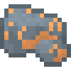
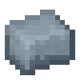

# Uru

{ width="100" height="100" loading=lazy }{ width="100" height="100" loading=lazy }

The "**Uru**" can be found only in ["**Mjolnir Crashsite"**](../../structures/mjolnir-crashsite.md) and requires a "**Diamond Pickaxe or higher to mine**".

Uses:

* Mining this ore will grant 1 piece of Raw Uru. This ore is affected by Fortune.

Crafting Uses:

* Using the blocks / ingots, various Asgardian armors, Iron Man suits and Hofund can be crafted.
* Using the Uru templates [Mjolnirs](../../powers/tertiary-powers/mjolnirs/index.md) / [Stormbreaker](../../powers/tertiary-powers/stormbreaker.md) / [Hofund ](../../powers/tertiary-powers/hofund.md)can be upgraded in the power menu.
* Use this ore the make Idunn Apple which will grant you one of the Asgardian Powers.
