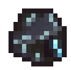
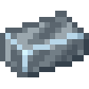
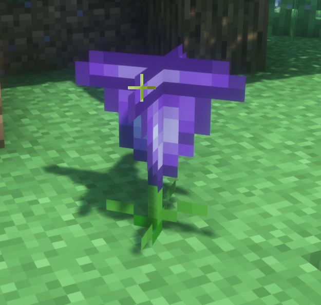

# Vibranium

{ width=100 height=99 loading=lazy } { width=100 height=100 loading=lazy }

The "**Vibranium**" can be found via the Palladium Meteor which is found very deep below a Heart-Shaped Herb and requires a "Diamond pickaxe or higher to mine".

Uses:

- Mining this ore will drop 1 piece of raw vibranium. This ore is affected by fortune.

Related Information:

- Vibranium Ingots can be used to craft [Adamantium Ingots](adamantium.md), Vibranium Shields, [Vibranium Circuits](../../items/technology/circuits/vibranium-circuit.md), Vibranium Flux-Capacitors, and the Nano-Housing Unit

Image of the Heart-Shaped Herb:

{ width="377" height="358" loading=lazy }
