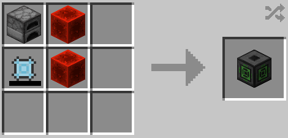

# RF Charger

{ width=191 height=187 loading=lazy }

The <em>RF Charger</em> can be obtained via crafting using the following recipe:

{ width=353 height=169 loading=lazy }

* After placing this block down, you must hold your fuel source in your mainhand (Coal or Charcoal), then you must hold the item you wish to charge in your offhand. One you've done this, right-click the block to use 1 fuel to gain +100 RF in the held item.

* This item **will not** charge more than 100 RF at a time. 
* This is a block designed to be used by anyone who does not wish to download / install any other RF charging mod.
