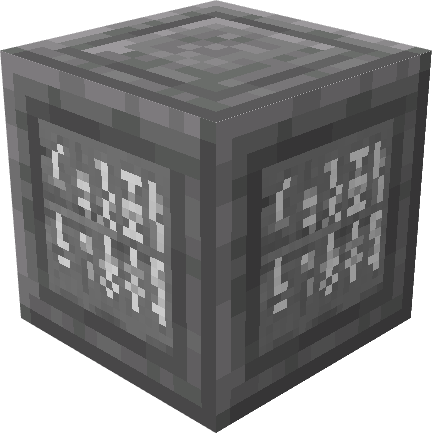

# Runic Block

{  loading=lazy }

The *Runic Block* can be obtained via “combining a crafting table, an ender pearl, a stone block and a glass bottle in a crafting grid”.

Uses:
- This block can be used to give an unemployed villager the Wizard job.

Related Information:
- This block requires a pickaxe of any level to be mined, and cannot be mined via an empty hand.
