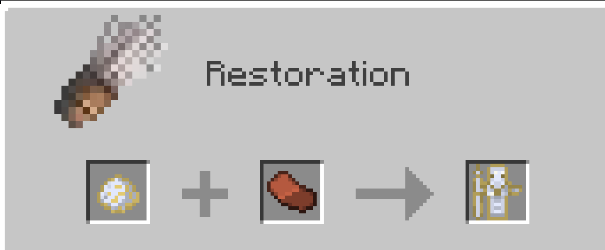

# Amazonian Artifact

{ width="100" height="100" loading=lazy }

The Amazonian Artifact is obtained by combining [Amazonian Clay ](../material/amazonian-clay.md)and an Ancient Clay Shard in an Archeology Table.

{  loading=lazy }

Uses:

* This item can grants the user one of the [Amazonian](../../powers/main-powers/amazon/index.md) on right click.
