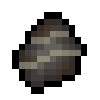

# Kree Fossil

{ width=100 height=100 loading=lazy }

The _Kree Fossil_ can be obtained via a 40% chance when mining the Kree Skeleton which is found on a [Fallen Kree Ship](../../../structures/fallen-kree-ship.md) in the End dimension.

* This fossil can be used to craft the [Kree-Hybrid](../../../powers/main-powers/kree-hybrid.md) power.
