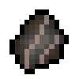

# Viltrumite Fossil

{ width=100 height=100 loading=lazy }

The _Viltrumite Fossil_ can be obtained via a 40% chance when mining the Viltrumite Skeleton which is found on a [Fallen Viltrumite Ship](../../../structures/fallen-viltrumite-ship.md) in the End dimension.

* This fossil can be used to craft each of the various [Viltrumite ](../../../powers/main-powers/viltrumites/index.md)variant powers.
