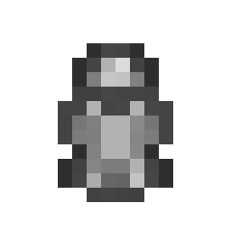
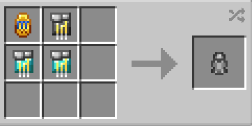
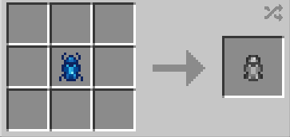
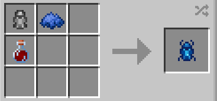

# Unaugmented Scarab Base

{ width="96" height="96" loading=lazy }

The **"Unaugmented Scarab Base"** can be obtained via crafting with x1 Scarab Compass, 2x [Diamond Circuits](../technology/circuits/diamond-circuit.md), and x1 [Titanium Circuit](../technology/circuits/titanium-circuit.md), or with any color [Scarab](../../powers/secondary-powers/scarabs.md).

{ width=412 height=206 loading=lazy }

{ width=414 height=197 loading=lazy },

{ width=416 height=195 loading=lazy }

Uses:

- Unaugmented Scarab Bases are used to craft [Scarabs](../../powers/secondary-powers/scarabs.md).

Related Information:

- Putting a [Scarab](../../powers/secondary-powers/scarabs.md) in a crafting grid will yield an Unaugmented Scarab, which you can then use to craft a different color Scarabs.
- Scarab Compasses can be found via using a brush on suspicious sand.
