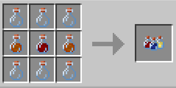

# Assorted Chemicals

{ width=130 height=92 loading=lazy }

The **"Assorted Chemicals"** can be obtained by using 6x Glass Bottle, 2x [Dark Matter Sample](dark-matter-sample.md) and 1x [Augmented Human DNA](material/augmented-human-dna.md) in a crafting table;

{ width="359" height="179" loading=lazy }

Uses:

* Consuming this item and getting strike by lightning will grant you one of the [Speedforce ](../powers/main-powers/speedforce/index.md)variants.

Related Information:

* Getting which [Speedster ](../powers/main-powers/speedforce/index.md)after consuming this is random chance.
