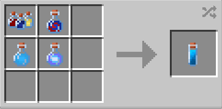

# Compound V

{ width=100 height=100 loading=lazy }

The **"Compound V"** can be obtained by using 1x [Assorted Chemicals](assorted-chemicals.md), 1x [X-Gene](x-gene.md), 1x [Super Soldier Serum](super-soldier-serum.md) and 1x [Galactic Cluster Sample](galactic-cluster-sample.md) in a crafting table:

{ width="272" height="135" loading=lazy }

Uses:

* Consuming this item will grant you one of the [Supes ](../powers/main-powers/supes/index.md)variant.

Related Information:

* Getting which [Supe ](../powers/main-powers/supes/index.md)variant after consuming this is random chance.
