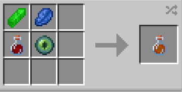

# Dark Matter Sample

{ width="100" height="100" loading=lazy }

The **"Dark Matter Sample"** can be obtained by using 1x [Kryptonite Shard](../blocks/ores/kryptonite.md), 1x Lapis Lazuli, 1x [Augmented Human DNA](material/augmented-human-dna.md) and 1x Eye of Ender in a crafting table:

{ width="271" height="137" loading=lazy }

Uses:

* Consuming this item will grant you one of the [Meta Human](../powers/main-powers/meta-humans/index.md) variants.

Related Information:

* Currently only [Meta Human](../powers/main-powers/meta-humans/index.md) in the addon is [Geokinesis](../powers/main-powers/meta-humans/geokinesis.md).
