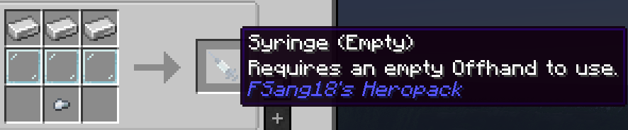

# Empty Syringe

{ width=100 height=100 loading=lazy }

Empty Syringes can be crafted by putting 3 iron ingots on top of 3 glass panes with one iron nugget below

{ width="665" height="138" loading=lazy }

Uses:

* Empty Syringes can be used to remove and store any currently equipped power or DNA when right-clicking without crouching. To take your "Player's Human DNA," crouch and right-click.
