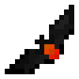

# Batarangs

{ width="100" height="100" loading=lazy }{ width="100" height="100" loading=lazy }{ width="100" height="100" loading=lazy }{ width="100" height="100" loading=lazy }{ width="100" height="100" loading=lazy }{ width="100" height="100" loading=lazy }{ width=100 height=100 loading=lazy }

Here, you'll be able to find more information on the various Batarangs within the addon.

* [Batarang - Normal](normal.md)
* [Batarang - Explosive](explosive.md)
* [Batarang - Shock](shock.md)
* [Batarang - Flame](shock.md)
* [Batarang - Frost](frost.md)
* [Batarang - Kryptonite](kryptonite.md)
* [Batarang - Sonic](sonic.md)
