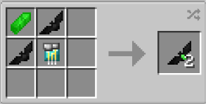

# Kryptonite

{ width="100" height="100" loading=lazy }

**Kryptonite Batarangs** can be obtained via crafting with 1x [Kryptonite ](../../../blocks/ores/kryptonite.md)Shard, 1x Diamond Circuit, and x2 [Batarangs (Normal) ](normal.md)in a crafting table, yielding x2 Kryptonite Batarangs.

{ width=279 height=140 loading=lazy }

Uses:

* Kryptonite Batarangs can be thrown to create an area of effect that applies Kryptonite Poisoning for 5 seconds, and deals 5 damage. This can be used to weaken [Full Kryptonians](../../../powers/main-powers/kryptonians-full/index.md) and [Half Kryptonians](../../../powers/main-powers/kryptonians-half/index.md).
* Up to x8 of these can be stored in any Utility Belt.
