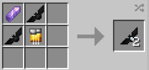

# Sonic

{ width="100" height="100" loading=lazy }

**Sonic Batarangs** can be obtained via crafting with 1x Amethyst Shard, 1x Golden Circuit, and x2 [Batarangs (Normal) ](normal.md)in a crafting table, yielding x2 Sonic Batarangs.

{ width="281" height="131" loading=lazy }

Uses:

* Sonic Batarangs can be thrown to give targets Slowness II and Sound Poisoning II for 5 seconds, deals 5 damage on impact. This can be used to weaken [Symbiotes](../../../powers/secondary-powers/symbiotes/index.md), [Viltrumites](../../../powers/main-powers/viltrumites/index.md), [Full Kryptonians](../../../powers/main-powers/kryptonians-full/index.md),[ Half-Kryptonians](../../../powers/main-powers/kryptonians-half/index.md), [Bone Claws](../../../powers/main-powers/mutations-x-gene/bone-claws/index.md) and [Lupine](../../../powers/main-powers/mutations-x-gene/lupine.md).
* Up to x16 of these can be stored in any Utility Belt.
