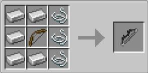

# Compound Bow

{ width=100 height=100 loading=lazy }

**Compound Bow** is obtained via crafting with x5 Iron Ingots, x3 Strings, and x1 Bow in a crafting table.

{ width=308 height=153 loading=lazy }

Uses:

* Compound Bow can be used to shoot Trick Arrows and Vanilla Arrows.
