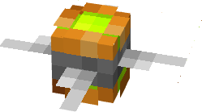
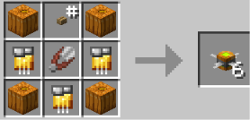

# Blades

{ width=249 height=139 loading=lazy }

**Blades Pumpkin Bombs** can be obtained via crafting with x4 Pumpkin, x3 Golden Circuit, 1 Button, and 1 Shear in a crafting table, yielding x6 Blades Pumpkin Bombs.

{ width="280" height="135" loading=lazy }

Uses:

* Blades Pumpkin Bombs can be thrown, dealing 3 damage on hit.
* Max stack size is 32.
