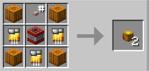

# Explosive

{ width="106" height="95" loading=lazy }

**Explosive Pumpkin Bombs** can be obtained via crafting with x4 Pumpkin, x3 Golden Circuit, 1 Button, and 1 TNT in a crafting table, yielding x2 Explosive Pumpkin Bombs.

{ width="325" height="155" loading=lazy }

Uses:

* Explosive Pumpkin Bombs can be thrown and creates an explosion, fire, and deals damage around it.
* Max stack size is 8
