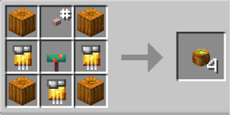

# Gas

{ width=94 height=103 loading=lazy }

**Gas Pumpkin Bombs** can be obtained via crafting with x4 Pumpkin, x3 Golden Circuit, 1 Button, and 1 Warped Fungus in a crafting table, yielding x4 Gas Pumpkin Bombs.

{ width=294 height=147 loading=lazy }

Uses:

* Gas Pumpkin Bombs can be thrown and creates an area of effect of gas and gives Poison III for 8 seconds anyone in the area.
* Max stack size is 16.
