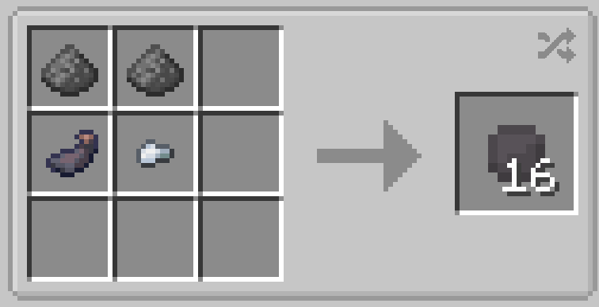

# Smoke Pellet

{  loading=lazy }

**Smoke Pellets** can be obtained via crafting with x2 Gunpowder, x1 Iron Ingot, and x1 Ink Sac in a crafting table, yielding x16

{  loading=lazy }

Uses:

- Throwing a smoke pellet will result in a cloud of smoke upon impact.
- Up to x64 of these can be stored in any Utility Belt
