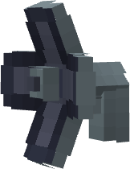

# Sound Gun

{ width=116 height=150 loading=lazy }

The Sound Gun can be obtained via crafting with x4 Iron Ingots, x2 Redstone Flux Crystals, x2 [Iron Circuits](../technology/circuits/iron-circuit.md), and x1 Note Block in a crafting table:

{ width=386 height=187 loading=lazy }

Uses:

- The Sound Gun is used to inflict sound poisoning upon targets, causing worse effects to those who are weak to sound
- The Sound Gun can store 5,000 RF

Related Information:

- The Sound gun requires RF to use
- Powers weak to sound are [Symbiotes](../../powers/secondary-powers/symbiotes/index.md), [Lupine](../../powers/main-powers/mutations-x-gene/lupine.md), [Bone Claws](../../powers/main-powers/mutations-x-gene/bone-claws/index.md), [Half Kryptonians](../../powers/main-powers/kryptonians-half/index.md), [Full Kryptonians](../../powers/main-powers/kryptonians-full/index.md), and [Viltrumites](../../powers/main-powers/viltrumites/index.md)
