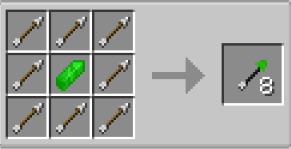

# Kryptonite Arrow

{ width=100 height=100 loading=lazy }

**Kryptonite Arrow** is obtained via crafting with x8 Arrow and x1 Kryptonite Shard in a crafting table.

{ width=274 height=140 loading=lazy }

Uses:

* An arrow that deals extra damage to Kryptonians.
* This arrow will give Kryptonite Poisoning effect on hit.
