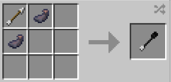

# Smoke Arrow

{ width=100 height=100 loading=lazy }

**Smoke Arrow** is obtained via crafting with x1 Arrow and x2 Ink Sac in a crafting table.

{ width=218 height=105 loading=lazy }

Uses:

An arrow that creates a cloud of smoke on it's target.
