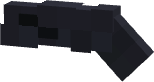
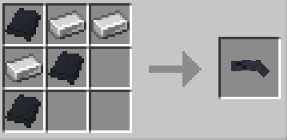

# Utility Gun

{ width="154" height="82" loading=lazy }

**Utility Gun** can be obtained via crafting with x3 Iron Ingot and x3 Black Basic Fabric in a crafting table. This gun needed to be in offhand to work. 

{ width="334" height="162" loading=lazy }

Right-Click while holding in your offhand to use.

Right-Click with a minecraft:lead in your mainhand to refill.

Max uses of grapple is 100.

1 Lead refills 25 uses.
