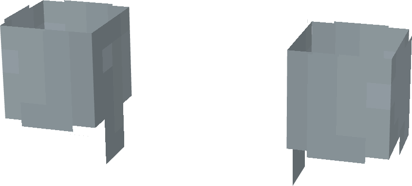
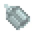
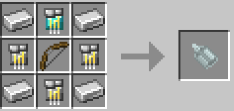

# Prototype Web-Shooters

{ width="259" height="116" loading=lazy }

{  loading=lazy }

The **Prototype Web-Shooters** can be obtained via crafting by using 4x Iron Ingots, 1x Diamond Circuit, 3x Iron Circuits and 1x Bow as seen below:

{ width="236" height="112" loading=lazy }

Uses:

- Slot 1 (Non-Crouch): **Web Zip** - Attach a web to a block within 30 blocks in the direction you are looking to be pulled towards it. This ability costs 2 WF when used (even if your target is out of range).
- Slot 2 (Non-Crouch): **Web Shot** - Fire off a high velocity ball of webs which can deal 2 damage when a target is hit. This ability costs 5 WF and has a cooldown of 1/4 seconds.

Related Information:

- These Web Shooters have a max Capacity of 1,000 WF (Web Fluid)
- When wearing any chest piece, these web shooters will become hidden.
- This gadget requires right-clicking on [Web Cartridge](../../technology/web-cartridge.md) while equipped to fill it.
