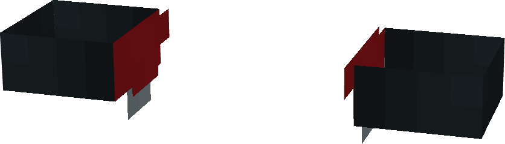
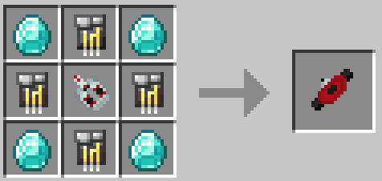

# Advanced Web-Shooters

{ width="252" height="72" loading=lazy }

{  loading=lazy }

The **Advacned Web-Shooters** can be obtained via crafting by using 4x Diamonds, 3x Netherite Circuit, 1x Titanium Circuits and 1x [Upgraded Web-Shooter](web-shooters2.md) as seen below:

{ width="238" height="113" loading=lazy }

Uses:

- Slot 1 (Non-Crouch): **Web Zip** - Attach a web to a block within 30 blocks in the direction you are looking to be pulled towards it. This ability costs 2 WF when used (even if your target is out of range).
- Slot 2 (Non-Crouch): **Web Shot** - Fire off a high velocity ball of webs which can deal 2 damage when a target is hit. This ability costs 5 WF and has a cooldown of 1/4 seconds.
- Slot 2 (Non-Crouch): **Impact Web Blast** - Fire off a larger ball of webs which can deal 6 damage when a target is hit, and will trap them in a cobweb. This ability costs 20 WF and has a cooldown of 2 seconds.
- Slot 2 (Non-Crouch): **Concussion Web Blast** - Fire off a ball of webs which can deal 1 damage when a target is hit, and hot with a Knockback of 3. This ability costs 15 WF and has a cooldown of 2 seconds.
- Slot 2 (Non-Crouch): **Shock Web Blast** - Fire off a ball of webs enhanced by electricity which can deal 2 damage when a target is hit, and applies the Shock effect for 4 seconds on the target that is hit. This ability costs 25 WF and has a cooldown of 2 seconds.
- Slot 2 (Non-Crouch): **Web Grenade** - Fire off a large ball of condensed webs which can deal 6 damage when a target is hit, and creates a non-destructive explosion when hit. This ability costs 50 WF and has a cooldown of 3 seconds.
- Slot 2 (Crouch): **Change Web-Type** - Switch through all of your available web types in your 2nd Slot.

Related Information:

- These Web Shooters have a max Capacity of 8,000 WF (Web Fluid)
- When wearing any chest piece, these web shooters will become hidden.
- This gadget requires right-clicking on [Web Cartridge](../../technology/web-cartridge.md) while equipped to fill it.
