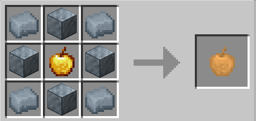

# Idunn Apple

{ width="100" height="100" loading=lazy }

The **"Idunn Apple"** can be obtained by using 4x [Uru Ingot](../blocks/ores/uru.md), 4x [Uru Block](../blocks/ores/uru.md) and 1x Golden Apple in a crafting table;

{ width=273 height=130 loading=lazy }

Uses:

* Consuming this item will grant you one of the [Asgardian ](../powers/main-powers/asgardians/index.md)variant.

Related Information:

* Getting which [Asgardian ](../powers/main-powers/asgardians/index.md)variant after consuming this item is random chance.
