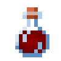
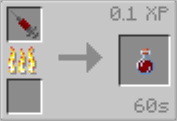

# Augmented Human DNA

{ width="100" height="100" loading=lazy }

The Augmented Human D.N.A Sample can be obtained by Smelting a [Human D.N.A Sample](human-dna-sample.md);

{ width="354" height="242" loading=lazy }

Uses:

* Can be smelted in order to obtain the [Super Soldier Serum](../../powers/main-powers/super-soldiers/index.md).
* Can be used in crafting
  * [Techno-Organic Ingots](../../blocks/ores/techno-organic-ingot.md)
  * [X-Gene](../x-gene.md)
  * [Dark Matter Sample](../dark-matter-sample.md)
  * [Gamma Radiation](../gamma-radiation.md)
  * [Assorted Chemicals](../assorted-chemicals.md)
  * [Scarabs](../../powers/secondary-powers/scarabs.md)
  * [Matter Absorbtion](../../powers/main-powers/matter-absorption.md)
  * [Kree Hybrid](../../powers/main-powers/kree-hybrid.md)
  * [Anti Matter](../../powers/main-powers/anti-matter.md)
  * [Artificial Necrotech](../../powers/main-powers/artificial-necrotech.md)
  * [Artificial Symbiote](../../powers/secondary-powers/symbiotes/artificial.md)
  * [Half Kryptonians](../../powers/main-powers/kryptonians-half/index.md)
  * [Sand Control](../../powers/main-powers/sand-infused-human.md)
  * [Arachnids](../../powers/main-powers/arachnids/index.md)
  * [Viltrumite - Human Hybrid](../../powers/main-powers/viltrumites/human-hybrid.md)
