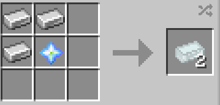

# Cosmic Ingot

{ width="100" height="100" loading=lazy }

Cosmic Ingots can be obtained via crafting 3x Iron Ingots and 1x [Cosmic Particle](../cosmic-particle.md) in a crafting table;

{ width="359" height="172" loading=lazy }

Uses:

* The Cosmic Ingot can be used to craft the Empty Phoenix Totem.
