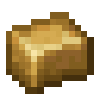
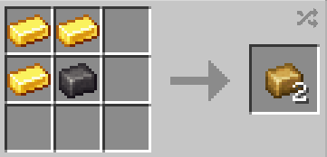

# Gold Titanium Alloy

{ width=100 height=100 loading=lazy }

Gold-Titanium Alloy can be obtained via crafting with x3 Gold Ingots and x1 [Titanium](../../blocks/ores/titanium.md) Ingot, yielding x2 Gold-Titanium Alloy:

{ width=271 height=131 loading=lazy }

Uses:

- Gold-Titanium Alloy is used to craft Iron Man Template 3 Suit and Conquest Gauntlet.
