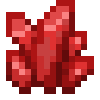
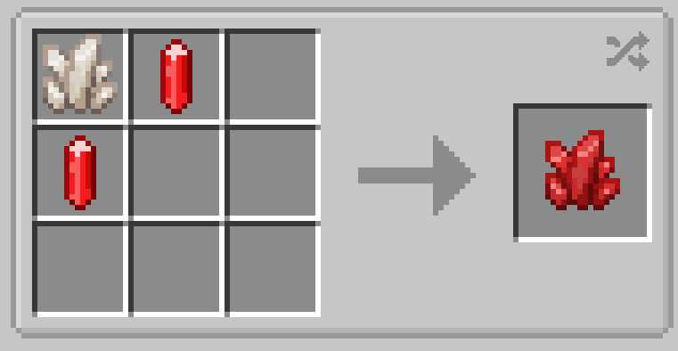

# Ruby Quartz

{ width=100 height=100 loading=lazy }

**Ruby Quartz** is obtained via crafting with x2 Redstone Flux Crystals, and x1 Nether Quartz in a crafting table.

{  loading=lazy }

Uses:

- Ruby Quartz is used in crafting the X-Gene, Cyclop's Visors, and Ruby-Quartz Glasses.

Related Information:

- Redstone Flux Crystals are acquired by breaking Redstone Flux Geodes, which can be found in Redstone veins.
