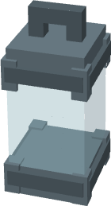
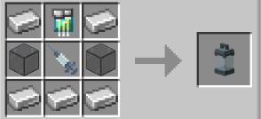

# Symbiote Container

{ width=105 height=194 loading=lazy }

**Symbiote Container** is obtained via crafting with x5 Iron Ingot, x2 Tinted Glass, x1 [Diamond Circuit](technology/circuits/diamond-circuit.md) and x1 [Empty Syringe](empty-syringe.md) in a crafting table.

{ width=312 height=141 loading=lazy }

Uses:

* It can be used to extract symbiotes, Right-Click it with empty offhand while having any [Symbiote](../powers/secondary-powers/symbiotes/index.md) power.
* You can place it down to the ground with right click.
