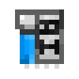
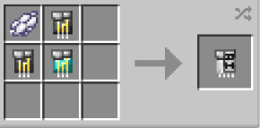

# AI Chips

{ width="100" height="100" loading=lazy }{ width="100" height="100" loading=lazy }{ width="100" height="100" loading=lazy }{ width="100" height="100" loading=lazy }{ width="100" height="100" loading=lazy }{ width="100" height="100" loading=lazy }{ width="100" height="100" loading=lazy }{ width="100" height="100" loading=lazy }{ width="100" height="100" loading=lazy }{ width="100" height="100" loading=lazy }

**AI Chips** can be obtained via crafting with x1 Netherite Circuit, x4 Titanium Circuit, x1 Diamond and respective color of AI with a blueprint book inside a crafting table.

{ width="265" height="131" loading=lazy }

**Uses:**

* When wearing any Iron Man-Type Helmet / Suit, Right-Click this item in your mainhand to equip it directly into your suit's Helmet.
* If you already have a AI Chip inserted, you can either Right-Click a new one in your offhand to swapp them out, or Crouch + Right-Click the helmet in your offhand to remove the AI Chip currently installed.
  * Nano Suits: Right-Click to AI chip in your mainhand while nano suit equipped for inserting the Chip. For removing Crouch + Right-Click with a empty mainhand.
  * Hulkbusters: Right-Click to AI chip in your mainhand while nano suit equipped for inserting the Chip. For removing Crouch + Right-Click with a empty mainhand.
* Equipping AI Chip will drain your Arc Reactor's RF energy at a slow rate. Using commands will increase the drain speed.
* Theres currently 10 AI Chip available in the addon. They all function the same, only differences is varying lines and characters of AI's, which is purely cosmetic. Available AI Chips and their colors to craft are;
  * **J.A.R.V.I.S. -** White
  * **E.D.I.T.H. -** Light Blue
  * **F.R.I.D.A.Y. -** Pink
  * **H.E.L.E.N. -** Orange
  * **K.A.R.E.N. -** Cyan
  * **K.A.T.I.E. -** Gray
  * **M.O.T.H.E.R.B.O.A.R.D. -** Black
  * **P.E.P.P.E.R. -** Red
  * **T.A.D.A.S.H.I. -** Purple
  * **T.O.N.Y. -** Blue
  * **V.E.R.O.N.I.C.A. -** Green

> How to use AI Commands:

* To activate your AI, type it's name in the chat.
* **AI Systems - Highlight:** Say "Tag All" in the chat to highlight all entities around you in a 30 block radius. saying "Tag Off" will disable it.
  * Saying "Tag Passive", "Tag Hostile" or "Tag Player" will only highlight the chosen entity-type.
* **AI Systems - Energy Readings:** Say "Energy Check" in the chat to passively have your AI alert you to your Arc Reactor's energy levels. Saying "Stop Energy Check" will stop the passive checks. This does not drain any RF to have active.
* **AI Systems - Health Readings:** Say "Health Check" in the chat to passively have your AI alert you to your health levels. Saying "Stop Health Check" will stop the passive checks. This does not drain any RF to have active.
* **AI Systems - Take Screenshot:** Say "Clip That" in the chat to take a screenshot which will be saved in the designated "screenshots" folder in your minecraft folder.
* **AI Systems - Night Vision:** Say "Night Vision On" in the chat to enable Night Vision Mode. Say "Night Vision Off" to disable the Night Vision Mode.
* **AI Systems - Target HUD:** Say "Target HUD On" in the chat to enable the HUD for scanning targets.
  * Say "Target HUD Scan" while looking at a target to store their name and current Health on your HUD. Say "Target HUD Off" to disable the HUD.
* **AI Systems - Read:** Say "Read" in the chat to have the link to that blueprint's suit sent to you by your AI.
* **AI System - Help:** Say "Cheat Sheet On" in the chat to have all the available AI commands displayed on your HUD. Say "Cheat Sheet Off" to disable the HUD.
