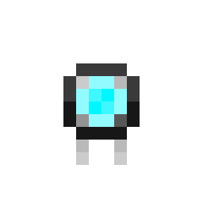
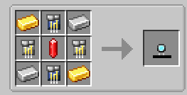

# Core

{ width=102 height=102 loading=lazy }

The Arc Reactor is obtained via crafting with x2 Iron and Gold, 2 Lead Circuits, 2 Iron Circuits, and a Redstone Flux Crystal in a crafting table

{ width=439 height=223 loading=lazy }

Uses:

- The primary use of the Core is to be used in crafting the Arc Reactors
- The Arc Reactor Core can be also used to store 500 RF

Related Information:

* The Arc Reactor core cannot be worn and is not usable to power Iron Man suits
