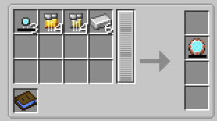

# Model I

{ width="107" height="107" loading=lazy }

The **Model I Arc Reactor** can be obtained via crafting with x3 [Arc Reactor Cores](core.md), x4 [Gold](../circuits/gold-circuit.md) and [Iron Circuits](../circuits/iron-circuit.md) and x6 Iron with a blueprint book in a tailoring table.

{ width="486" height="272" loading=lazy }

Uses:

* The Model I Arc Reactor can store 10,000 RF and is used to power[ Iron Man Suits](../../../suitsets/iron-man-suits/index.md) in order to use their abilities
* When charged with at least 100 RF, the reactor becomes self-sustaining and will slowly generate power in inventory, more when equipped.

Relevant Information

* To power an [Iron Man Suit](../../../suitsets/iron-man-suits/index.md), the arc reactor needs to be equipped in the curios:body slot.
