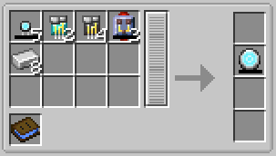

# Model II

{ width="122" height="122" loading=lazy }

The **Model II Reactor** can be obtained via crafting with x5[ Arc Reactor Cores](core.md), x2 [Diamond Circuits](../circuits/diamond-circuit.md), x4[ Netherite Circuits](../circuits/netherite-circuit.md), x2 Lead Flux Capacitor, x8 Iron with a blueprint book in a tailoring table.

{ width="492" height="278" loading=lazy }

Uses:

* The Model II Arc Reactor can store 25,000 RF and is used to power [Iron Man Suits](../../../suitsets/iron-man-suits/index.md) in order to use their abilities
* When charged with at least 100 RF, the reactor becomes self-sustaining and will slowly generate power in inventory, more when equipped.

Relevant Information

* To power an[ Iron Man Suit](../../../suitsets/iron-man-suits/index.md), the arc reactor needs to be equipped in the curios:body slot
* This Arc Reactor's recipe becomes unlocked after crafting the [Model 9](../../../suitsets/iron-man-suits/model-9.md) suit.
