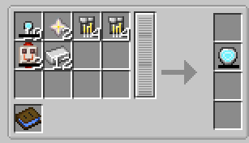

# Model III

{ width="125" height="125" loading=lazy }

The **Model III Arc Reactor** can be obtained via crafting with x10 [Arc Reactor Cores](core.md), x2 Nether Stars, x4 [Titanium](../circuits/titanium-circuit.md) and [Netherite Circuits](../circuits/netherite-circuit.md), x2 Quartz Flux Capacitors, x12 Iron with a blueprint book in a tailoring table.

{ width="450" height="257" loading=lazy }

Uses:

- The Model III Arc Reactor can store 50,000 RF and is used to power[ Iron Man Suits](../../../suitsets/iron-man-suits/index.md) in order to use their abilities
- When charged with at least 100 RF, the reactor becomes self-sustaining and will slowly generate ppower in inventory, more when equipped.

Relevant Information

* To power an [Iron Man Suit](../../../suitsets/iron-man-suits/index.md), the arc reactor needs to be equipped in the curios:body slot.
* This reactor is unlocked after crafting the [Model 50](../../../suitsets/iron-man-suits/model-50.md) suit.
