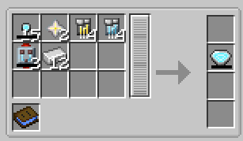

# Model IV

{ width="91" height="91" loading=lazy }

The Model IV Arc Reactor can be obtained via crafting with x15 [Arc Reactor Cores](core.md), x2 Nether Stars, x4 [Titanium and Vibranium Circuits](../circuits/vibranium-circuit.md), x2 Vibranium Flux Capacitors, and x12 Iron with a blueprint book in a tailoring table.

{ width="515" height="300" loading=lazy }

Uses:

- The Model IV Arc Reactor can store 100,000 RF and is used to power [Iron Man Suits](../../../suitsets/iron-man-suits/index.md) in order to use their abilities
- When charged with at least 100 RF, the reactor becomes self-sustaining and will slowly generate power in inventory, more when equipped.

Relevant Information

* To power an [Iron Man Suit](../../../suitsets/iron-man-suits/index.md), the arc reactor needs to be equipped in the curios:body slot.
* This Arc Reactor's recipe becomes unlocked after crafting the [Model 70](../../../suitsets/iron-man-suits/model-70.md) suit.
