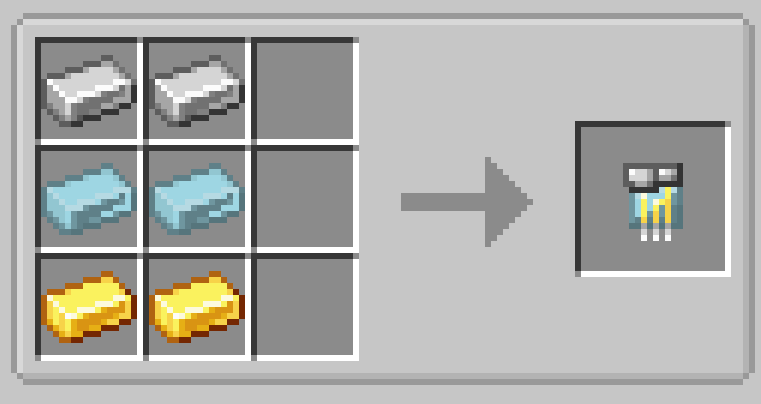

# Adamantium Circuit

{ width=100 height=100 loading=lazy }

Adamantium Circuits are obtained by putting x2 Iron Ingots, x2 Adamantium Ingots, and x2 Gold Ingots in a crafting table.

{  loading=lazy }

Uses:

- Adamantium Circuits are used to craft various different [Suitsets](../../../suitsets/index.md) and [Technology](../index.md)
