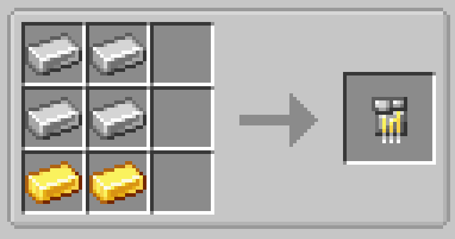

# Iron Circuit

{ width=100 height=100 loading=lazy }

**Iron Circuits** can be obtained via putting x4 iron ingots and x2 gold ingots in a crafting table.

{  loading=lazy }

Uses:

- Iron Circuits are used to craft various different [Suitsets](../../../suitsets/index.md) and [Technology](../index.md)
