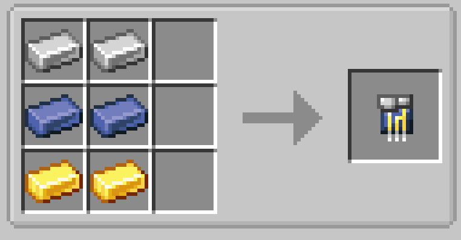

# Lead Circuit

{ width=100 height=100 loading=lazy }

Lead Circuits can be obtained via crafting with x2 Iron Ingots, x2 Lead Ingots, and x2 Gold Ingots in a crafting table:

{  loading=lazy }

Uses:

- Lead Circuits are used in crafting all forms of Web Shooters, The Arc Reactor Core, and The Lead Flux Capacitor
