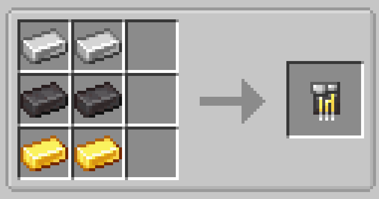

# Netherite Circuit

{ width=100 height=100 loading=lazy }

Netherite Circuits are obtained via x2 Iron Ingots, x2 Netherite Ingots, and x2 Golden Ingots in a crafting table.

{  loading=lazy }

Uses:

- Netherite Circuits are used to craft various different [Suitsets](../../../suitsets/index.md) and [Technology](../index.md)
