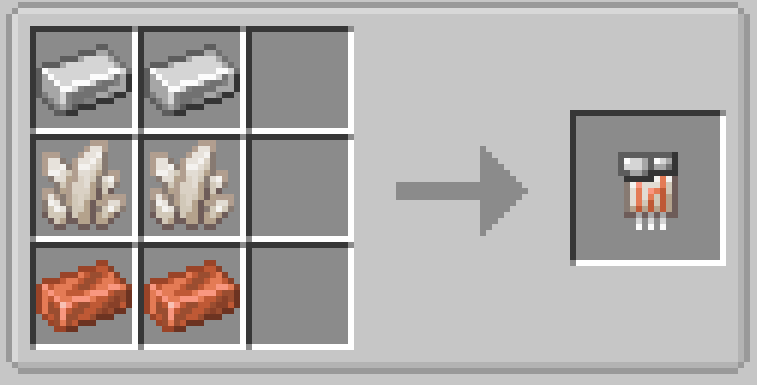

# Quartz Circuit

{ width=100 height=100 loading=lazy }

Quartz Circuits can be obtained via crafting with x2 Iron Ingots, x2 Nether Quartz, and x2 Copper Ingots in a crafting table:

{  loading=lazy }

Uses:

- Quartz Circuits are used to craft the Prototype Web Shooters and the Sound Gun
