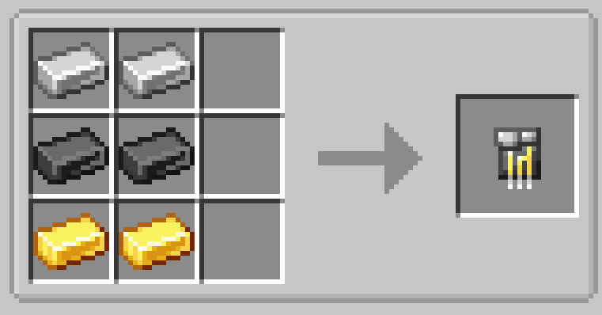

# Titanium Circuit

{ width=100 height=100 loading=lazy }

The **Titanium Circuit** is made in a crafting table with x2 Iron ingots, x2 Titaniums ingots, and x2 Gold ingots

{  loading=lazy }

Uses:

- The Titanium Circuit are used to craft various different [Suitsets](../../../suitsets/index.md) and [Technology](../index.md)
